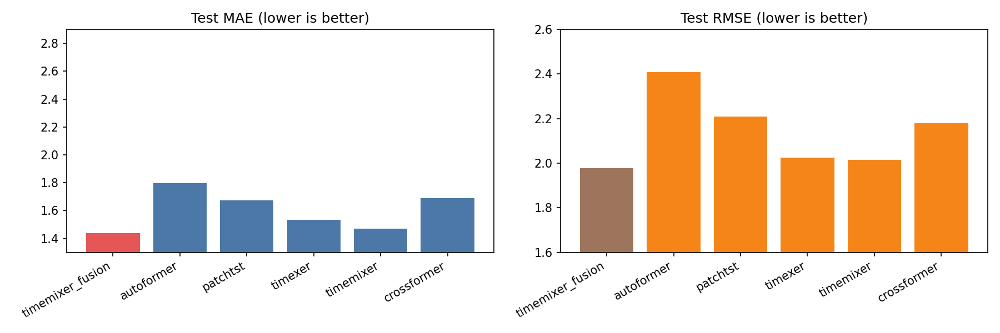

# TimeRAG 结果汇总

## 算法简介
- TimeMixer Fusion（Ours）：在 TimeMixer 基线上加入检索结果辅助分支，通过 cross-attention 与残差融合提升预测。
- Autoformer（2021）：通过序列分解（趋势/季节）与自相关机制替代标准注意力，擅长建模长周期依赖并提升长序列预测效率。
- PatchTST（2023）：把时间序列切成 patch 作为 token 输入 Transformer，减少序列长度并强化局部模式建模，适合中长序列预测。
- TimeXer（2024）：基于 PatchTST 结构，引入全局 token 与交互注意力以汇聚全局信息并增强跨 patch 依赖建模。
- TimeMixer（2024）：多尺度下采样后进行趋势/季节混合，并融合各尺度预测，强调多分辨率时序特征提取。
- CrossFormer（2023）：对时间维与变量维分别做注意力交互（segment-wise + dimension-wise），再融合两类依赖以提升多变量时序预测能力。

## 结果汇总（来自 outputs/*/metrics.json）

| 算法 | test_mae | test_rmse |
|---|---:|---:|---:|
| timemixer_fusion | 1.4398 | 1.9764 |
| autoformer | 1.7951 | 2.4089 |
| patchtst | 1.6714 | 2.2102 |
| timexer | 1.5347 | 2.0244 |
| timemixer | 1.4698 | 2.0151 |
| crossformer | 1.6874 | 2.1797 |

## 指标图表

